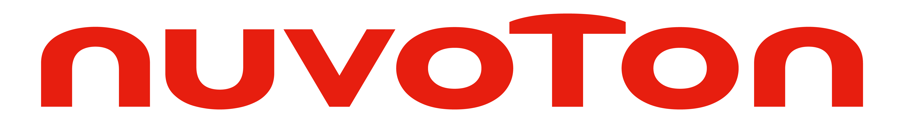
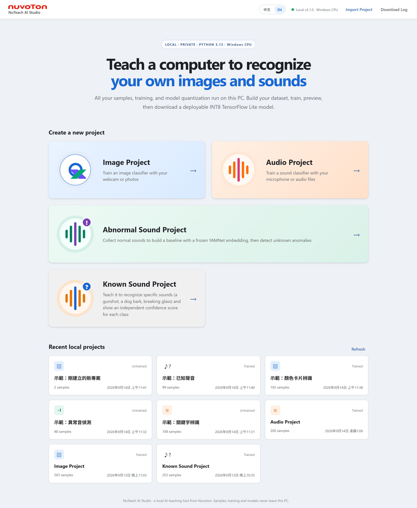

<p align="center">
  
</p>

<h1 align="center">NuTeach AI Studio</h1>

<p align="center">
  <strong>Teach a computer to see and hear — then run the model on a Nuvoton M55M1 board.</strong><br>
  A no-code machine-learning classroom tool that runs entirely on a local Windows PC.
</p>

<p align="center">
  
  
  
  
</p>

<p align="center"><strong>English</strong> · <a href="#繁體中文">繁體中文</a></p>



## Overview

NuTeach AI Studio lets students build their own AI models without writing code. They collect
photos with a webcam or recordings with a microphone, train a model in the browser, test it live,
export it as TensorFlow Lite, and build firmware for Nuvoton NuMaker M55M1 boards (Arm Cortex-M55
with an Arm Ethos-U55 NPU).

Everything runs on `127.0.0.1`: there is no account, no cloud service, and no photo or recording
ever leaves the PC.

```text
Create classes → Collect samples → Train → Preview → Export TensorFlow Lite → Build & flash firmware
```

### Highlights

- **No code, no account, no cloud** — a browser UI served by the PC itself, in Traditional
  Chinese or English.
- **Four project kinds** — image classification, keyword spotting, multi-label sound detection
  and anomaly detection.
- **From PC to board in one dialog** — the Studio compiles the model for the NPU with Arm Vela,
  builds the firmware with the Arm GNU toolchain, and can flash it for you.
- **Strict integer models** — every INT8/UINT8 export is checked for integer I/O, leftover float
  tensors and Flex ops; a mixed-precision model is never labelled INT8.
- **Built for classrooms** — two double-click entry points, CPU-only by design so every PC behaves
  the same, and a diagnostic log that never contains images or audio.

## Project kinds

The kind is chosen when a project is created and cannot be changed afterwards.

| Kind | Question it answers | Scores | Runs on a board |
|---|---|---|---|
| **Image** | Which of these things is in front of the camera? | Sum to 100% | X board, GestureAI |
| **Audio** (keyword spotting) | Which keyword or short sound was that? | Sum to 100% | X board, GestureAI, VoiceAI |
| **Known Sound** | Which named sounds are present right now? (several at once) | Independent confidence per class | X board, GestureAI, VoiceAI |
| **Abnormal Sound** | How far is this from normal? (never names the sound) | One deviation score | PC only |

Known Sound and Abnormal Sound are not interchangeable: Known Sound *names* sounds and needs every
class collected, including Background; Abnormal Sound is trained on Normal sounds only.

## Supported boards

| Board | Camera | Results shown on | Flashing from the Studio |
|---|---|---|---|
| NuMaker-M55M1 (X board) | Yes | Built-in LCD + serial port | Nu-Link Command Tool (on-board Nu-Link) |
| NuMaker-GestureAI-M55M1 | Yes | USB camera overlay + USB serial port | USB mass-storage bootloader (default) or Nu-Link |
| NuMaker-VoiceAI-M55M1 | No | USB serial port | pyocd + external Nu-Link2 |

Firmware templates, the M55M1 BSP subset and the Vela NPU compiler ship in
[`mcu_toolkit/`](mcu_toolkit/). No Keil and no separate SDK download are needed — only the free
Arm GNU toolchain (see *Getting started*).

## Requirements

- Windows 10 or 11, 64-bit
- 64-bit CPython **3.13.x** (not the free-threaded `3.13t` build) — the official installer is
  included in [`0_Python_3.13.15/`](0_Python_3.13.15/)
- An internet connection for the first installation
- A webcam and/or a microphone for collecting samples
- For dev boards: the Arm GNU Toolchain 14.2.rel1 and one of the flashing tools below

## Getting started

1. **Get the code** into a short path, for example:

   ```bat
   git clone https://github.com/OpenNuvoton/NuTeach-AI-Studio.git "C:\NuTeach AI Studio"
   ```

   or use **Code → Download ZIP** and extract it to `C:\NuTeach AI Studio`. Long paths break the
   firmware build later.
2. **Install Python 3.13** from `0_Python_3.13.15\` and tick *Add python.exe to PATH*.
3. **Double-click `01_INSTALL.bat`.** It creates the project's own `.venv`, installs TensorFlow
   and verifies the setup with a real train → export → strict-INT8 round trip.
4. **Double-click `02_START.bat`.** The browser opens `http://127.0.0.1:8765`. After the last
   Studio tab is closed, the console exits by itself about 8 seconds later (never while a job is
   still running).
5. **For dev boards only**, install the Arm GNU toolchain once:

   ```bat
   .venv\Scripts\python.exe scripts\download_arm_toolchain.py
   ```

Projects, samples and trained models live in `workspace/`. If the environment ever breaks, close
the Studio, delete only `.venv` and run `01_INSTALL.bat` again — **never delete `workspace/`**.
The repository starts with an empty `workspace/`; the classroom package handed to students also
contains four trained sample projects.

### Flashing tools

- **X board, or GestureAI over Nu-Link:** install the Nu-Link Command Tool from
  [`2_Compiler and Download Tool Driver/`](2_Compiler%20and%20Download%20Tool%20Driver/).
- **GestureAI over USB mass storage:** nothing to install.
- **VoiceAI:** connect an external Nu-Link2 and run
  `.venv\Scripts\python.exe scripts\setup_voiceai_flash.py` once (installs pyocd and the Nuvoton
  device pack).
- To record samples with a board's own microphone or camera, flash a firmware from
  [`1_Collect_Firmware_bin/`](1_Collect_Firmware_bin/) first.

## Documentation

| Document | Contents |
|---|---|
| [USER_GUIDE_en.md](USER_GUIDE_en.md) | Full user guide: installation, the four project kinds, every training setting, flashing a board, troubleshooting |
| [使用手冊_zh-TW.md](使用手冊_zh-TW.md) | 完整使用手冊（繁體中文），內容與英文版相同 |
| [docs/MCU_DEPLOY_zh-TW.md](docs/MCU_DEPLOY_zh-TW.md) | Firmware build pipeline, memory budgets and error messages |
| [docs/MCU_AUDIO_INT8_zh-TW.md](docs/MCU_AUDIO_INT8_zh-TW.md) | Audio front-end specification shared by the PC and the board |
| [docs/KNOWN_SOUND_zh-TW.md](docs/KNOWN_SOUND_zh-TW.md), [docs/ABNORMAL_SOUND_YAMNET_zh-TW.md](docs/ABNORMAL_SOUND_YAMNET_zh-TW.md) | Design of the two YAMNet-based project kinds |
| [docs/RELEASE_NOTES_zh-TW.md](docs/RELEASE_NOTES_zh-TW.md) | Release notes |
| [CLAUDE.md](CLAUDE.md) | Developer notes: architecture, design decisions and conventions |

## Design principles

- **Windows CPU only, deliberately.** Even with an NVIDIA GPU present, training and export run on
  the Windows CPU runtime — no WSL, no CUDA, one `.venv` — so every classroom PC behaves the same.
- **Train and Export are separate jobs.** Training produces only `.keras`, so Preview is available
  at once; TensorFlow Lite conversion runs later in its own subprocess and cannot damage the
  trained model.
- **Any change to samples or settings invalidates the trained model,** including built firmware.
- **Firmware constants are generated, never hand-copied.** Labels, model arrays, arena size,
  quantization parameters and the mel/Hann tables are derived at build time from the training and
  conversion reports, so the PC and the board cannot compute different spectrograms.

## Repository layout

```text
01_INSTALL.bat / 02_START.bat          the only two entry points for students
0_Python_3.13.15/                      official Python 3.13 installer
1_Collect_Firmware_bin/                firmware that turns a board into a USB microphone or camera
2_Compiler and Download Tool Driver/   Nu-Link Command Tool installer
nuteach/                               FastAPI server: projects, training, export, firmware pipeline
web/                                   browser UI (Traditional Chinese / English)
mcu_toolkit/                           vendored firmware templates, M55M1 BSP subset, Vela compiler
reference/                             stand-alone reference scripts for all four project kinds
scripts/                               installer, toolchain download and vendoring utilities
tests/                                 pytest suite, including architecture guardrails
docs/                                  design documents, release notes and screenshots
workspace/                             student projects, samples and models (git-ignored)
```

## Development

```bat
rem test-only dependencies (not part of requirements.txt)
.venv\Scripts\python.exe -m pip install pytest httpx

rem full suite, or skip the slow end-to-end training tests
.venv\Scripts\python.exe -m pytest
.venv\Scripts\python.exe -m pytest -m "not slow"

rem quick checks
.venv\Scripts\python.exe scripts\start_local.py --check
node --check web\app.js
```

Tests that need a board, MSVC or the Arm toolchain skip themselves when those are missing.
`tests/test_distribution.py` is an architecture guardrail rather than a logic test: it asserts the
design decisions above as strings, so it fails first when the architecture changes — confirm the
change is intended, then update the assertions. Code style: Python 3.13,
`from __future__ import annotations`, ruff with line length 100.

## License

Apache License 2.0 — see [LICENSE.txt](LICENSE.txt).

NuTeach AI Studio is not sponsored by, endorsed by, or affiliated with Google; "TensorFlow" and
"Google" are trademarks of their respective owners. The Nuvoton logo (`web/nuvoton_logo.png`) is a
trademark of Nuvoton Technology Corporation and is not covered by the Apache License. Third-party
components — YAMNet, the Nuvoton NuML toolkit and M55M1 BSP, tflite-micro, CMSIS and the Arm Vela
compiler — keep their own licenses; see [NOTICE.md](NOTICE.md) and
[mcu_toolkit/NOTICE_third_party.md](mcu_toolkit/NOTICE_third_party.md).

---

## 繁體中文

### 簡介

NuTeach AI Studio 是一套不用寫程式、完全在本機 Windows 電腦執行的機器學習教學工具：用 Webcam 或麥克風
收集樣本、在瀏覽器裡訓練、即時 Preview、匯出 TensorFlow Lite，再建置並燒錄 Nuvoton NuMaker M55M1
開發板（Cortex-M55 + Ethos-U55 NPU）的韌體。不需要帳號、不連雲端，圖片與錄音都不會離開這台電腦。

### 四種專案

| 種類 | 回答的問題 | 能上板 |
|---|---|---|
| Image（圖片） | 鏡頭前是哪一類？ | X 板、GestureAI |
| Audio（關鍵字） | 剛剛說了哪個關鍵字？ | X 板、GestureAI、VoiceAI |
| Known Sound（已知聲音） | 現在有哪些聲音？可以同時好幾種 | X 板、GestureAI、VoiceAI |
| Abnormal Sound（異常聲音） | 和正常的聲音差多少？ | 只在電腦上 |

### 快速開始

1. 把程式放到短路徑，例如 `C:\NuTeach AI Studio`（`git clone`，或 GitHub 的 **Code → Download ZIP**）。
2. 安裝 `0_Python_3.13.15\` 裡的 Python 3.13，記得勾選 *Add python.exe to PATH*。
3. 雙擊 `01_INSTALL.bat`（第一次需要網路）。
4. 雙擊 `02_START.bat`，瀏覽器會打開 `http://127.0.0.1:8765`。關掉所有 Studio 分頁後，黑色視窗約 8 秒會自己結束。
5. 要上開發板時，再執行一次 `.venv\Scripts\python.exe scripts\download_arm_toolchain.py` 安裝 Arm GNU 編譯器。

所有專案、樣本與模型都在 `workspace\`。環境壞掉時只刪 `.venv`，再重跑 `01_INSTALL.bat`，**不要刪 `workspace\`**。

### 文件

- 完整操作說明：[使用手冊_zh-TW.md](使用手冊_zh-TW.md)（英文版 [USER_GUIDE_en.md](USER_GUIDE_en.md)）
- 開發板部署、音訊前處理、Known Sound／Abnormal Sound 的設計：[docs/](docs/)
- 版本紀錄：[docs/RELEASE_NOTES_zh-TW.md](docs/RELEASE_NOTES_zh-TW.md)
